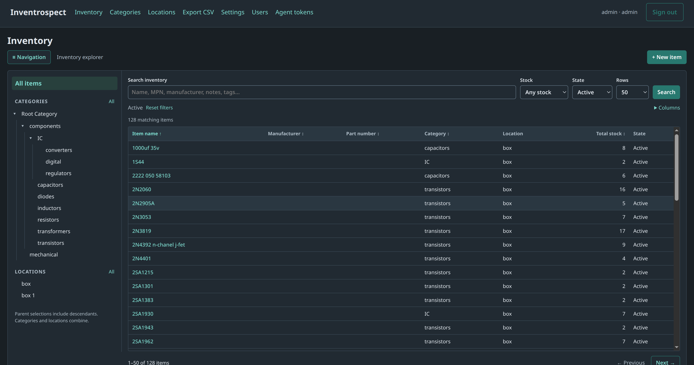

# Inventrospect

Inventrospect is a self-hosted engineering inventory application with a conventional web interface, REST API and MCP interface for AI agents.

Maintain inventory manually, or allow external AI agents to inspect and manage inventory, retrieve technical documents and reason about available components. Inventrospect itself does not require an LLM or provide built-in AI features.

## Who is it for?

- Makers
- Workshops
- R&D laboratories
- Makerspaces
- Universities

## What is it not designed for?

- Retail
- Purchasing and vendor management
- Large-scale enterprise deployments

## Capabilities

- Searchable components, categories, locations and structured attributes.
- Whole-number stock adjustments, movements and history.
- Datasheets, photos and other attachments with integrity checks.
- User roles, scoped agent tokens, token-specific write limits and audit attribution.
- SQLite and local document storage; no external database or cloud services.
- Light/dark themes and an inventory explorer.



## Docker quick start

Install Docker Engine with the Compose plugin. The quick start pulls the published image from GHCR; Go and local compilation are not required. From a checkout of this repository (or a directory containing `compose.yaml` and `.env.example`):

```bash
cp .env.example .env
docker compose pull app mcp backup
# One-time administrator setup (Bash; choose a 12–72-byte password).
read -rsp 'Initial admin password: ' password; echo
printf '%s\n' "$password" | docker compose run -T --rm --no-deps app \
  -data=/data -init-admin -admin-password-stdin
unset password
docker compose up -d
```

Open [http://127.0.0.1:8080](http://127.0.0.1:8080) and sign in as `admin`. Both published ports bind only to loopback. Subsequent starts need only `docker compose up -d`. Administrator setup is deliberately explicit: there is no default password.

The application and MCP adapter run in separate containers using one non-root image. MCP accesses inventory through REST and never mounts the database. The named `data` volume retains SQLite, users, token hashes, sessions and uploaded documents across container replacement. **Do not run `docker compose down -v` against a real installation.**

## MCP and permissions

As an administrator, open **Agent tokens**, select an acting user and only the required scopes, then copy the one-time secret into your client's protected credential storage. Connect using Streamable HTTP at `http://127.0.0.1:8081/mcp` with `Authorization: Bearer <your token>`.

Read-only clients generally need `inventory:read`, `stock:read` and `documents:read`. Write scopes are independent; permanent item deletion requires `inventory:delete` and an active admin owner. Tokens have per-token write and bulk limits (defaults: 600 write units/minute and 100 records). Revocation and owner permissions are checked on use. See [MCP documentation](docs/mcp.md).

## Operations

Use the supported offline archive commands to back up SQLite and all attachments together. Stop both services first; copying a live `.db` file alone is unsafe. See [deployment, backup/restore and upgrade instructions](docs/deployment.md), including HTTPS reverse proxy configuration, bind mounts and orphan reconciliation.

Images and binaries are produced by the [tagged release workflow](docs/releases.md). The quick start uses `ghcr.io/sigmatechnica/inventrospect:latest`. For predictable upgrades, set `INVENTROSPECT_IMAGE` in `.env` to a specific published version tag or digest and follow the backup-before-upgrade procedure.

## Development

To build and run containers from a source checkout, see [local container builds](docs/development.md).

Use Go 1.27.2 as selected by `go.mod`; Node 24 runs the dependency-free UI tests.

```bash
go test ./...
go vet ./...
go run golang.org/x/vuln/cmd/govulncheck@v1.9.0 ./...
node --test internal/web/explorer.test.cjs
go build -o bin/inventrospect ./cmd/server
go build -o bin/inventrospect-mcp ./cmd/mcp
go build -o bin/inventrospect-ops ./cmd/ops
```

The application embeds its HTML/CSS/JavaScript. There is no frontend package installation. See [contributing](CONTRIBUTING.md) and the retained [API/development reference](docs/api-and-development.md).

## AI

Inventrospect is built with Codex and Claude.

## Security and licence

Use HTTPS for remote access, protect backups as credentials, and give agents the least privilege they need. Authorised deletion is permanent; keep tested offline backups. See [security policy](SECURITY.md).

Licensed under the **GNU Affero General Public License, version 3 (AGPL-3.0)**. The existing [LICENSE](LICENSE) is unchanged.
